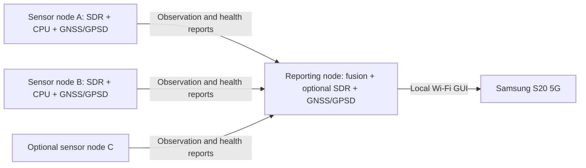

# Distributed nodes and GPSD — design and implementation status

WaveRaider will use one operator-carried reporting node and two or three
operator-carried sensor nodes. The reporting node can also receive RF, for three
or four receiving sites in total. CPU processing runs on each field computer;
the Samsung S20 5G displays the reporting node's web GUI over local Wi-Fi.
Intel NUC and Jetson-class hosts are initial targets. Raspberry Pi is a prospective
reduced-workload target, subject to USB, power, thermal and processing measurements.
No particular hardware combination or detection latency is validated yet.

The current development build includes a first CLI implementation of authenticated
HTTPS heartbeat/recording-summary reporting, an optional local GPSD snapshot reader,
and bounded opt-in bladeRF micro IQ recording. See [node quickstart](node-quickstart.md).
The recorder currently supports bladeRF micro receivers. Node reporting uses standard
HTTPS over a reachable IP network, independent of the network equipment or vendor.
Ethernet, Wi-Fi, routed networks, VPNs and other IP transports can provide connectivity;
validate routing, firewall access and outage recovery on the chosen deployment.
The GNSS receiver model and physical receiver/network combination still need validation.

An opt-in Monitor panel now presents local coordinator health and recording summaries.
Continuous live detection, capture-position history and TDOA remain unimplemented. The current Monitor still replays samples. A node location
is never a drone location. The sections below describe the full target architecture;
the initial CLI does not yet meet all delivery gates.

## Roles and data flow

Each node captures locally, screens signals and performs supported detection checks.
It sends compact evidence and health reports, rather than continuously streaming all
IQ to the reporting operator. Local bounded volatile IQ buffers support short event
snippets for later correlation; size, duration and bandwidth budgets must be fixed
before implementation. Persistent raw-IQ recording is off by default and needs an
explicit capture/retention decision. No automatic model retraining uses field data.

The reporting node associates observations of the same transmission, preserves
per-node evidence, and presents all observations together. Multiple reports do not
imply multiple aircraft. A frequency match alone is not enough to associate emitters.
TDOA fusion is a later stage that uses matching snippets and verified sample timing.

## GPSD on every receiving node

An onboard GNSS module or compatible USB GPS puck feeds a local GPSD service.
WaveRaider reads GPSD locally (normally loopback port 2947); GPSD itself is not
exposed as the inter-node service. Validate device compatibility and the exact
receiver/adapter combination before purchasing a fleet.

Position reports retain:

- Node ID, boot/session ID and GNSS device/source ID.
- Fix mode: no fix, 2D or 3D; receiver-reported status when supplied.
- Latitude/longitude, altitude only when valid, and its datum (ellipsoid versus MSL).
- Receiver fix epoch and local monotonic receipt time, kept distinct.
- Available horizontal/vertical uncertainty, speed and track with source semantics.
- Fix age and state: valid, stale, unavailable or disconnected.

GPSD fields can be absent and TPV reports can arrive in parts. Never replace missing
coordinates, uncertainty or altitude with zero. Merge only compatible reports from
the same device and fix epoch; do not attach an old position to a new timestamp.
Do not interpret every GPSD error field as a guaranteed 95% confidence interval:
the upstream documentation warns that receiver confidence conventions vary.
A 2D fix does not supply valid altitude. Device selection must be explicit when
GPSD exposes more than one receiver.

Maintain a bounded position history so an observation refers to the node position
at capture time, not when its network message arrives. Reject association beyond
configured age/uncertainty limits; interpolation must account for motion and the
fix-time uncertainty. Numeric thresholds need measurement on the chosen equipment.
A last-known position can remain on the GUI with its age, but cannot silently become
a current localization input. Receiver track is direction of travel, not a compass
heading; a future antenna-array bearing also needs measured array orientation.

## Position and sample synchronization are separate

A GPS fix locates the sensor. GPSD time reports can support event logging and host
clock discipline, but they do not establish the arrival time of RF samples.
USB transport, receiver output latency and host scheduling affect timing. A
PPS-capable receiver is useful only if its pulse is physically exposed through a
verified timing path; a USB puck's marketing description is not enough.

TDOA requires a measured mapping between each SDR sample counter and a common time
reference, plus sample-rate stability, receiver/cable delay calibration and
uncertainty bounds. A hardware PPS/reference-clock arrangement is a candidate,
not a confirmed plug-and-play bladeRF wiring scheme. PPS alignment and continuous
frequency discipline solve different parts of the problem. GPSD, NTP/chrony or
Wi-Fi packet arrival times alone must never set the TDOA-ready flag.

Report these independently:

| State | Meaning |
| --- | --- |
| Position valid | Node has an acceptable position estimate for the relevant time |
| Host clock synchronized | OS clock has a stated source and error estimate |
| Sample timing validated | SDR sample-to-time mapping and rate/delay error meet the measured budget |
| Localization eligible | Matching event, usable positions, timing, calibration and geometry all pass |

Loss of GPS/PPS or reference lock must age out eligibility. Holdover is allowed only
with a measured drift model and time limit; otherwise suppress localization and
continue labeled detection reporting. Never extrapolate a hardware sample clock
across a device restart, timestamp reset or unaccounted sample loss.

## Reporting and fusion contract

Before building transport, version the report schema and define size/queue limits.
Each report should include node/boot/sequence/event IDs; evidence type and detector
version; center frequency, sample rate and coverage; capture interval/sample counter;
clock domain and measured timing uncertainty; position reference; receiver health and
drop counts; optional bounded snippet reference and content hash. Detection scores
are not probabilities of aircraft presence unless independently calibrated.

Authenticate nodes and protect messages in transit. The existing unauthenticated web
server must not become a remotely accessible command or ingestion API unchanged.
Allowlist enrollment, bound input sizes, deduplicate retransmissions and report
sequence gaps. On network loss, continue local operation with bounded queues and
explicit data-loss counts. Report age uses capture time and known clock uncertainty,
not merely packet receipt time. Wi-Fi range/topology and link budgets remain to be
chosen; no reliance on internet connectivity is intended.

Moving operators need spatial separation and usable geometry. Three sites can
constrain a 2D solution under explicit assumptions; do not silently place an aircraft
on the ground. Four sites do not guarantee a reliable 3D solution when geometry is
poor. Show uncertainty and decline solutions with insufficient constraints. The
located emitter might be a controller; it is not automatically a drone.

## Delivery order and acceptance gates

1. **GPSD adapter and health model.** Implement replayable TPV/device fixtures and
   tests for no fix, partial updates, stale fixes, reconnects, changing devices,
   missing fields and clock discontinuities. Add node-position status without a
   TDOA-ready claim. Validate a real onboard/USB receiver when available.
2. **Authenticated node reporting.** Run a coordinator and simulated sensor clients;
   test duplicate, delayed, out-of-order, malformed and missing messages, bounded
   queues and coordinator restart. Present detection and receiver/position health
   together, keeping simulated inputs visibly separate.
3. **Continuous CPU detection.** Establish measured minimum host specifications,
   capture throughput, worst-case latency, coverage/revisit gaps and overload
   behavior. Keep GPU acceleration optional; do not promise operation on any NUC.
4. **Two-radio timing experiment.** Observe a common known source in a controlled
   setup and measure relative timing bias/drift across retunes, restarts, temperature
   changes and dropped samples. Verify the exact PPS/reference/trigger hardware.
   Set an error budget before relying on clock lock indicators.
5. **Moving multi-node localization.** Test known source locations and surveyed
   trajectories with three/four nodes, poor geometry, multipath, GNSS loss and
   network loss. Establish error distributions and the conditions under which the
   GUI must withhold a location. AoA remains an optional complementary capability.

## Primary references

- [GPSD JSON protocol](https://gpsd.io/gpsd_json.html): TPV fields, optional values and uncertainty semantics.
- [GPSD time service](https://gpsd.io/gpsd-time-service-howto.html): message latency, PPS and USB timing limitations.
- [GPSD compatible receivers](https://gpsd.io/hardware.html): device/transport support.
- [Nuand reference clocks](https://www.nuand.com/frequently-asked-questions/): external reference and clock input/output capabilities.
- [libbladeRF triggers](https://www.nuand.com/bladeRF-doc/libbladeRF/v2.6.0/group___f_n___t_r_i_g.html): sampling synchronization interface; system performance still requires measurement.
